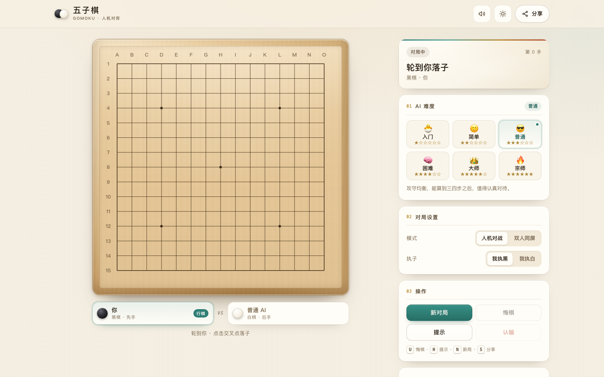
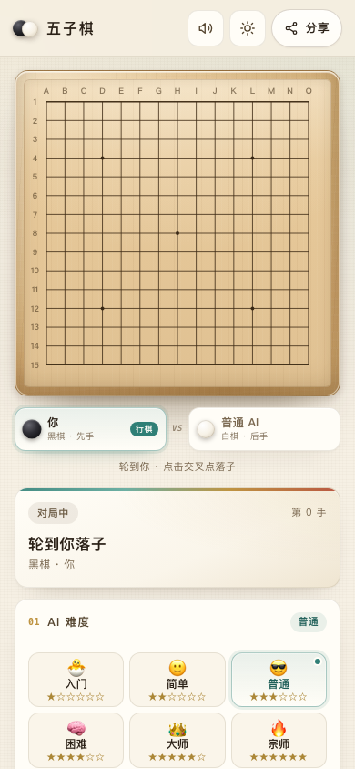
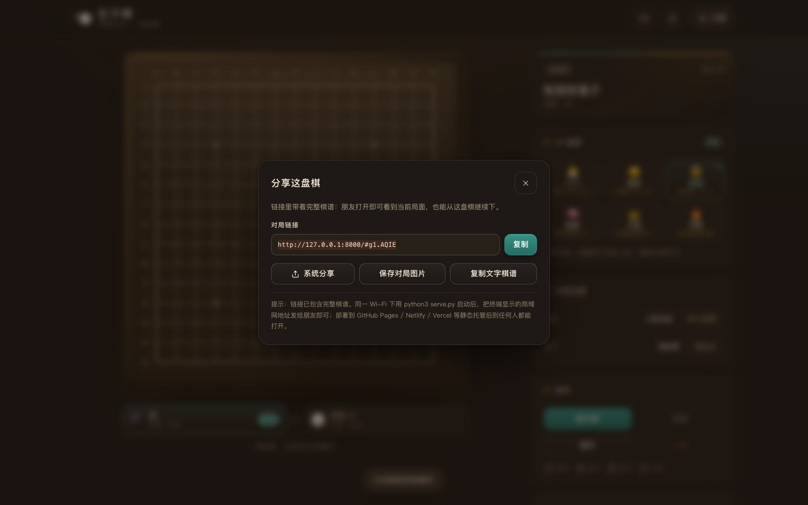
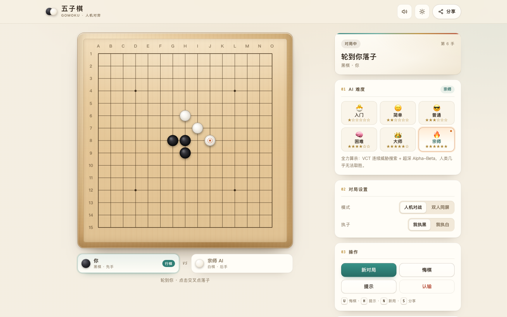

# 五子棋 · Gomoku

一个可以直接打开、无需后端、无需登录的五子棋网站：**六档 AI 难度（入门到宗师）**、双人同屏、悔棋 / 提示 / 回放、深浅主题，以及**可分享的棋局链接**——任何一盘进行中的棋都可以生成链接，发给朋友即可复原当前局面并继续对弈。

```
open http://localhost:8000        # 启动后浏览器访问
python3 serve.py                  # 零依赖本地服务器（推荐）
```

## 预览

| 桌面（浅色） | 移动端 |
| --- | --- |
|  |  |

<details>
<summary>深色模式与分享弹窗</summary>



宗师难度实战（VCT 算杀）：



</details>

## 功能

- **六档 AI 机器人**：入门 / 简单 / 普通 / 困难 / 大师 / 宗师，基于 Alpha-Beta 搜索 + 威胁搜索（活三、冲四、双三、VCF），宗师档额外加入 VCT 连续威胁算杀与 PVS 主变例搜索；难度越高搜索越深、越会做战术攻防。
- **人机对战 / 双人同屏**：可执黑或执白；人机模式自动轮转，AI 思考有计时与状态提示。
- **完整对局操作**：新局、悔棋（一次退两步）、AI 提示、认输、键盘快捷键（U 悔棋 / H 提示 / N 新局 / S 分享）。
- **分享即复原**：棋谱 + 难度 + 模式 + 执子方全部编码在 URL hash（`#g1.xxx`）里，打开链接就回到同一局面，可直接接着下；也可「复制文字棋谱」「保存对局图片」「系统分享」。
- **回放**：一键进入回放，前后逐手查看，随时退出继续对弈。
- **体验细节**：15×15 木纹棋盘、落子动画、最后一手标记、胜利连线高亮、深浅色主题、音效、移动端适配、`prefers-reduced-motion` 适配、无障碍焦点样式。
- **纯静态**：无构建、无第三方依赖、无网络请求，双击 `index.html`（file://）也能玩。

## 快速开始

需要 Python 3（macOS 自带即可）或任意静态文件服务器。

```bash
cd gomoku
python3 serve.py            # 默认 8000 端口，自动打印本机/局域网/Bonjour 地址
# 可选：--port 9000 --bind 0.0.0.0 --open
```

也可以直接：

```bash
python3 -m http.server 8000 -d gomoku
# 或直接双击 gomoku/index.html（file:// 模式，分享链接只对本机有效）
```

然后浏览器打开 `http://localhost:8000`。

## 分享给朋友

| 方式 | 做法 |
| --- | --- |
| 局域网（同一 Wi-Fi） | `python3 serve.py`，把终端打印的 `http://<局域网IP>:8000` 发给朋友 |
| 公网静态托管 | 把 `gomoku/` 目录（或 `dist/gomoku-standalone.html` 单文件）部署到 GitHub Pages / Netlify / Vercel / Cloudflare Pages，任何拿到链接的人都能打开 |
| 单文件版本 | `python3 build.py` 生成 `dist/gomoku-standalone.html`，整个网站就是一个 HTML 文件，方便发文件或放任意静态空间 |

网站内的「分享」按钮会生成带 `#g1.` 棋谱的链接；朋友打开即可看到当前棋盘并继续下一盘。

## AI 难度

| 档位 | 关键词 | 说明 |
| --- | --- | --- |
| 入门 novice | 新手 | 只做基础攻防，适合第一次接触五子棋 |
| 简单 easy | 放松 | 会补自己的活三、会挡明显冲四，但容易被做双威胁 |
| 普通 normal | 均衡 | 常规评分 + 浅层搜索，能算到几步之后，适合日常对局 |
| 困难 hard | 难缠 | 更深的 Alpha-Beta + 威胁搜索，几乎不会漏掉双三/冲四 |
| 大师 master | 很强 | 8 层深搜 + VCF 线路，攻守都很有压迫感，单步通常 1s 内 |
| 宗师 grandmaster | 终极 | VCT 连续威胁算杀 + 12 层超深搜索 + PVS，几乎不给人类翻盘机会；单步约 0.2~0.7s |

AI 引擎位于 `js/ai.js`，纯浏览器经典脚本，挂载 `window.GomokuAI`（`create(difficultyKey) → { chooseMove(board, player, ctx) }`）。

**强度实测**（`test/ai/bench.js`：每组 10 局、真实不同开局、交替先手；宗师档基准预算压到 1200ms 以缩短矩阵耗时）：
master:easy **9:1**、master:novice **10:0**、hard:easy **9:1**、normal:novice **10:0**、easy:novice **10:0**、master:hard **6:4**、grandmaster:master **8:2**、grandmaster:hard **8:2**。
前六组达标、六档整体单调无倒挂；宗师 vs 困难没到 9/10 门槛（换种子 7:3，合计 22/30，失败集中在宗师执白），已知局限与改进方向见 `test/ai/bench-results.md`。单步耗时（默认预算，限额）：master max 88ms（2500ms）、grandmaster max 443ms（3000ms）。

### 关于「战无不胜」

自由规则（无禁手）下黑棋先手存在理论必胜，任何 AI 都无法在数学上保证执白也必胜；宗师档的目标是「人类几乎无法取胜」：VCT 连续威胁算杀 + 12 层超深搜索 + PVS，并会主动化解你的 VCF/VCT。它在本仓库自对弈中稳定强于大师档；对普通人类玩家，正常对局基本没有翻盘机会。

## 项目结构

```
gomoku/
├── index.html               # 页面结构
├── css/style.css            # 全站样式（深浅主题 / 响应式）
├── js/core.js               # 棋盘规则、胜负判定、棋谱编码解码（GomokuCore）
├── js/ai.js                 # 六档 AI 引擎（GomokuAI，含 VCT/PVS 宗师档）
├── js/app.js                # 界面、对局流程、分享、回放（window.GomokuApp 调试接口）
├── serve.py                 # 零依赖本地服务器（自动打印局域网地址）
├── build.py                 # 打包单文件 dist/gomoku-standalone.html
├── test/
│   ├── core.js              # 规则核心 + 分享编解码自测（90 项断言）
│   ├── browser/chrome.py    # 无头 Chrome CDP 驱动（截图 / eval / 交互）
│   ├── browser/e2e.py       # 端到端测试（35 项）
│   └── ai/                  # AI 自测与对弈基准（181 项 + 耗时 + 强度矩阵，jsc 运行）
└── README.md
```

## 测试

```bash
# 规则核心 + 棋谱编解码（JavaScriptCore，无需 node）
/System/Library/Frameworks/JavaScriptCore.framework/Versions/A/Helpers/jsc test/core.js

# AI 自测 / 强度基准（详见 test/ai/）
/System/Library/Frameworks/JavaScriptCore.framework/Versions/A/Helpers/jsc test/ai/<脚本>.js

# 端到端（先 python3 serve.py，再另开终端）
python3 test/browser/e2e.py
```

## 技术说明

- 纯前端：HTML + CSS + 原生 JS（ES5 语法、无打包、无框架、无网络依赖）。
- 棋谱分享：`#g1.` + base64url 编码的字节流（版本、难度、模式/执子/尺寸 flags、逐手坐标），解码后按顺序重放即可复原任意局面。
- 棋盘用 `<canvas>` 绘制并按 devicePixelRatio 缩放，木纹与阴影由 CSS + Canvas 分层完成。
- 音效使用 Web Audio API 合成，无音频资源文件。

## License

MIT
